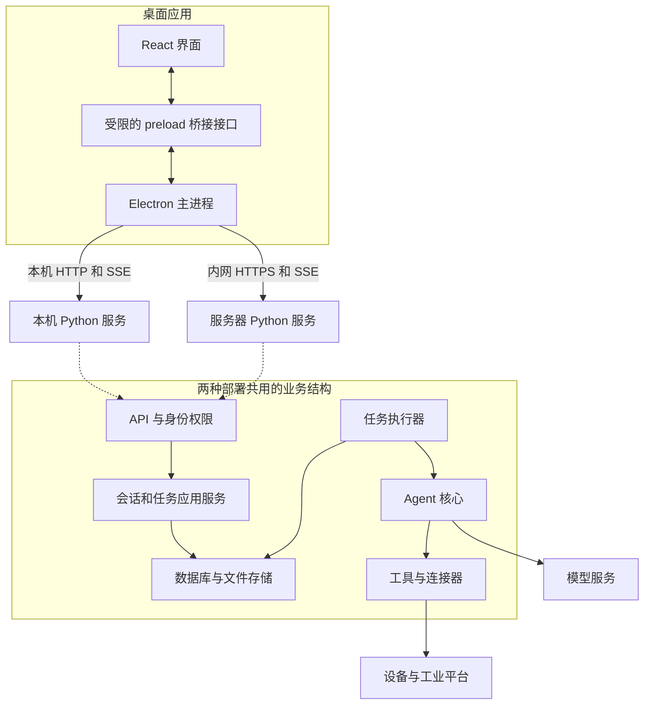
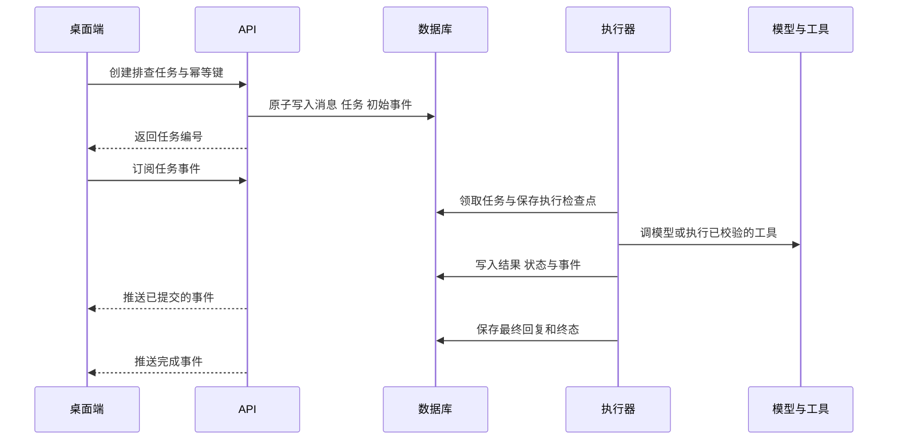

# 智能制造桌面 Agent 架构设计

日期：2026 年 10 月 16 日。状态：目标架构方案，完整产品尚未实现；切片状态见追踪表。产品范围以 [需求文档](requirements.md) 为依据，新增或调整的设计需同步 [追踪表](traceability.md) 和 [工程约束](engineering-constraints.md)。

产品采用 Electron、React、TypeScript、CSS 和 Python。桌面端先支持 Windows，后续扩展 macOS 和 Linux；Python 服务面向 Windows 和 Linux。本机和工厂内网服务器使用相同的业务服务与接口，客户端通过连接配置选择服务。

架构采用一个仓库、一个桌面应用、一个模块化 Python 服务。会话、任务、工具调用和证据拥有独立的数据模型。任务执行不依赖界面连接，任务状态与事件先存储，再推送给客户端。

## 1 产品范围

首版覆盖设备异常描述、多轮对话、工具排查、进度展示、证据查看、历史任务、本机与服务器连接。设备信息可以通过连接器按需查询；大规模实时设备看板、视频墙和 MES 全量功能不在首版范围。

处置动作先提供模拟执行和确认流程，再逐项开放真实连接器。系统展示执行步骤、依据和结果，不把模型的内部思维过程作为产品数据。

已确认的约束：

- 界面使用 React、TypeScript 和 CSS，桌面框架使用 Electron。
- 业务服务主要使用 Python，可以重新设计现有实现。
- 同时支持本机运行 Agent 和连接工厂内网 Agent 服务。
- Windows 桌面端优先，后续扩展 macOS 和 Linux。

## 2 现有实现与改造方向

| 现有位置 | 当前行为 | 新架构中的处理 |
| --- | --- | --- |
| `app/web/server.py` | HTML 内嵌于 Python；`POST /api/run` 等待整轮排查后返回 | React 独立构建；创建任务后立即返回任务编号，通过事件持续更新 |
| `app/agent/core.py` | 同步循环；有事件回调，但 trace 仅保存在内存 | 使用可取消的任务执行器，持久化状态、事件和调用结果 |
| `app/agent/llm.py` | 固定四类 intent 和取证规则；重建模型调用记录 | 模型适配器独立；保留实际消息和调用编号，场景约束由工作区策略提供 |
| `app/tools/registry.py` | 全局工具字典、字符串参数描述和 mock 数据 | 使用正式参数模型、工具元数据和可替换连接器 |
| `app/config.py` | 从源码附近读取配置，进程内缓存 | 区分部署配置、工作区设置和秘密凭据，任务记录配置版本 |

保留现有 mock 场景作为回归样例，保留状态查询、日志查询和 runbook 查询的业务意图。新业务核心不依赖旧的全局注册表或四类 intent。旧入口在新版本完成验收后再退出使用。

## 3 总体结构



图中的业务模块是代码职责边界，首版放在一个 Python 服务进程中。API 处理和任务执行使用独立的异步任务，数据库是任务与事件的事实来源。初期每个服务实例只运行一个 API 进程，避免随意增加 Uvicorn worker 导致执行器重复启动。

## 4 技术选型

| 部分 | 选择 | 用途 |
| --- | --- | --- |
| 桌面应用 | Electron + TypeScript | 应用窗口、系统交互、连接管理、本机服务管理 |
| 界面 | React + TypeScript + CSS Modules | 可复用组件、界面交互和样式 |
| 构建 | Vite + TypeScript 类型检查 | 开发调试、资源构建；类型检查单独作为必需步骤 |
| Python API | FastAPI + Pydantic | HTTP 接口、输入输出校验、OpenAPI |
| 任务执行 | asyncio 执行器 + 数据库任务表 | 并发控制、取消、持久化排队、执行恢复判定 |
| 数据访问 | SQLAlchemy + Alembic | 数据访问和数据库结构迁移 |
| 本机数据库 | SQLite | 单机持久化，无需额外安装数据库 |
| 服务器数据库 | PostgreSQL | 多用户访问、并发事务和集中备份 |
| 客户端通信 | HTTP 命令 + SSE 事件流 | 提交任务、查询历史、接收进度 |
| 打包 | Electron Forge + PyInstaller 目录模式 | Windows 安装包以及随包 Python 服务 |

Vite 支持 React TypeScript 项目；Electron Forge 提供 Electron 的打包和安装产物工具链。具体依赖版本在实现阶段锁定，并以打包验证通过的组合为准。[Vite 文档](https://vite.dev/guide/)、[Electron Forge 文档](https://www.electronforge.io/)

首版使用模块化服务和数据库队列。Redis、Celery、向量数据库、Kubernetes 和多 Agent 编排按实际需求引入。执行器通过接口隔离，后续可以独立为 worker 进程，业务模型与客户端接口保持兼容。

## 5 桌面端职责

### 5.1 界面进程

React 负责工作区、会话列表、聊天、任务进度、证据详情、操作确认和设置。组件调用统一的 `DesktopClient` 接口，不接触 Python 进程对象、数据库或凭据文件。

服务端数据由集中定义的查询与订阅层管理；输入内容、面板展开状态等使用 React 本地状态。聊天渲染与任务状态分离，生成中的文本不能决定任务是否完成。首版不强制引入额外的全局状态框架。

### 5.2 主进程与桥接接口

主进程管理窗口、连接配置、凭据、本机子进程、HTTP 请求和 SSE 订阅。preload 仅暴露具名方法，例如 `connections.select`、`runs.create`、`runs.subscribe`、`runs.cancel` 和 `artifacts.export`。

HTTP 与 SSE 在主进程统一处理，通过受限 IPC 将数据传给界面。这样可以统一携带认证信息和重连游标。IPC 参数与返回值需要运行时校验；TypeScript 类型不能替代外部输入检查。

生产界面从安装包加载，启用 `contextIsolation`、sandbox，关闭 `nodeIntegration`，设置内容安全策略。桥接层不暴露通用 shell、任意路径读写或任意 URL 请求接口；校验发送窗口和订阅所属连接。模型输出的 Markdown 禁用原始 HTML，外链使用允许的协议打开。[Electron 安全建议](https://www.electronjs.org/docs/latest/tutorial/security)、[上下文隔离](https://www.electronjs.org/docs/latest/tutorial/context-isolation)

## 6 两种部署模式

| 项目 | 本机模式 | 工厂服务器模式 |
| --- | --- | --- |
| Python 服务 | 随客户端安装，由主进程管理 | 独立安装为服务，由服务器管理员管理 |
| 数据 | 用户数据目录中的 SQLite 与文件 | PostgreSQL 与服务器文件卷 |
| 身份 | 当前操作系统用户对应的本机身份 | 服务端认证的用户和工作区成员 |
| 网络 | 仅监听 `127.0.0.1`，随机端口 | 经 HTTPS 入口访问 |
| 客户端关闭 | 关闭窗口默认隐藏到托盘，服务继续运行 | 不影响服务器任务 |
| 明确退出应用 | 停止接收新任务并收尾，退出本机服务 | 仅退出客户端 |
| 连接设备 | 从操作员电脑访问设备或平台 | 从服务器访问设备或平台 |

### 6.1 本机启动与退出

1. Electron 获取单实例锁，定位用户数据目录，读取连接配置。
2. 主进程用绝对路径启动随包 Python 服务，使用目录明确的参数，不通过 shell 拼接命令。
3. 主进程通过继承管道发送本次启动的随机令牌与实例标识。令牌不进入命令行、日志或 React 状态。
4. Python 绑定端口 `0`，由操作系统分配端口；完成数据库迁移和恢复检查后，通过启动管道返回端口和就绪信息。
5. 主进程验证令牌、实例标识、协议版本与健康状态，验证通过后开放业务操作。
6. 启动失败显示可理解的错误和诊断入口；不通过反复重启掩盖迁移或配置错误。

本机所有业务接口仍校验令牌，限制 Host 和 Origin，不开放跨站访问。本机单实例锁、用户目录锁和后台服务身份校验共同防止重复服务。

明确退出时先停止调度，协作取消正在执行的诊断步骤，并等待在途处置动作返回或进入待核对状态。宽限时间到期后仍未结束的任务记录为待恢复；退出不等于承诺已经撤销设备操作。后台服务监测父进程退出，异常失联后停止接收新任务、收尾并退出；Windows 使用进程树生命周期管理避免遗留子进程。

### 6.2 服务器运行

服务器独立运行相同的 Python 业务包，使用 PostgreSQL、持久文件卷和 HTTPS 入口。初期采用单服务进程加进程守护，支持多个客户端和受限任务并发；这不包含高可用承诺。

服务器模式包含账号认证、工作区权限和审计。首版提供受维护认证组件支持的账号登录与令牌会话，预留企业 OIDC 身份适配。登录限速、密码哈希和令牌撤销随认证功能一起交付。服务器运行模式不能因忘记配置认证而自动退化成匿名访问。

### 6.3 连接与执行位置

客户端保存多个连接配置：显示名称、模式、服务地址、部署标识、选中工作区、凭据引用。缓存键必须包含 `deployment_id` 和 `workspace_id`；切换连接时卸载旧订阅和缓存视图，避免不同工厂的数据混在一起。

运行中的任务归原连接所有。切换连接不迁移或重放任务；用户可以回到原连接查看。历史记录与附件不会自动跨部署同步，后续通过显式导入导出实现。

模型地址独立于部署模式：本机 Agent 可以连接内网模型。工具默认在 Python 服务所在主机执行。服务器无法访问的操作员电脑文件，需显式上传；服务器无法访问的设备需配置网络可达的连接器。后续可增加边缘连接器，但首版不通过桌面客户端隐式执行服务器下发的任意命令。

## 7 Python 服务模块

| 模块 | 职责 | 依赖边界 |
| --- | --- | --- |
| API | 校验请求、身份与资源权限、返回 DTO、输出 SSE | 调用应用服务，不直接调用模型 |
| 应用服务 | 会话、任务、操作提案和连接配置的用例 | 编排领域对象与存储接口 |
| 领域模型 | 任务状态、预算、权限策略、证据引用和状态转换 | 不依赖 FastAPI、Electron 或具体模型 SDK |
| 任务执行器 | 领取任务、执行检查点、取消、并发控制、心跳 | 调用 Agent 和存储接口 |
| Agent 核心 | 组装上下文、请求模型、选择工具、形成诊断 | 通过模型和工具接口获取能力 |
| 模型适配器 | 模型请求、响应规范化、超时与错误分类 | 不读取 HTTP 请求对象或直接写界面 |
| 工具层 | 参数模型、风险、权限、执行结果和状态核对 | 通过连接器访问外部系统 |
| 基础设施 | 数据库、凭据、文件、日志和网络实现 | 实现上层定义的接口 |

依赖由启动入口装配，避免全局可变工具字典。每个并发任务拥有独立数据库会话与模型上下文，不能共享一个 SQLAlchemy `AsyncSession`。[SQLAlchemy 并发说明](https://docs.sqlalchemy.org/en/20/orm/extensions/asyncio.html#using-asyncsession-with-concurrent-tasks)

## 8 会话与任务执行

会话 `Conversation` 是连续交流的容器；消息 `Message` 是用户输入和最终回复；任务 `Run` 是一次可跟踪的排查执行。一个会话可有多个历史任务，首版同一会话同时只有一个非终态任务。忙碌时新输入保留为草稿，界面可选择停止当前任务或新建会话。

用户提交输入时，在同一事务中写入用户消息、任务、首个事件和幂等记录，然后返回 `202 Accepted`。执行器只领取已经提交的任务，HTTP 连接中断不会丢失已创建的任务。

执行流程：



上下文只读取当前用户有权访问的会话、设备与证据。工具结果提供摘要和原始数据引用，避免将大段日志全部塞进模型。模型返回的工具参数经过 Pydantic 校验、工作区权限检查和策略判断后才执行。记录实际模型消息、工具调用编号、模型标识和配置版本；模型适配器负责格式兼容，不伪造调用历史。

模型决策可以是调用工具、请求用户补充或形成最终回复。请求补充时结束本轮并返回澄清消息，用户回复后创建新任务。四类 demo 故障只作为样例，模型不受固定 intent 枚举限制。检索 runbook 是工具能力，RAG 后续实现为同一工具接口的适配器。

## 9 状态与恢复

| 状态 | 含义 | 允许的下一状态 |
| --- | --- | --- |
| `queued` | 已持久化，等待执行 | `running`、`cancelled` |
| `running` | 执行中 | `awaiting_approval`、`cancelling`、`succeeded`、`failed`、`recovery_required` |
| `awaiting_approval` | 等待具体处置动作确认，释放执行槽 | `queued`、`cancelling`、`failed` |
| `cancelling` | 已请求停止，等待在途步骤收尾 | `cancelled`、`recovery_required` |
| `recovery_required` | 执行中断或外部结果不明确，需要核对 | `queued`、`failed`、`cancelled` |
| `succeeded` | 本次任务正常完成 | 终态 |
| `failed` | 任务失败，包括超时和预算耗尽 | 终态 |
| `cancelled` | 已停止执行后续步骤 | 终态 |

恢复状态转回排队前必须完成核对，生成新的执行尝试编号，并保留原记录。状态变更采用版本比较，状态、检查点与相应事件在同一事务提交。一个任务只能有一个执行所有者，数据库记录领取者和心跳。首版在服务重启后，原处于 `running` 或 `cancelling` 且失去执行所有者的任务进入 `recovery_required`，不自动重跑在途调用；尚未开始的排队任务和仍有效的待确认提案保留原状态。

工具调用拥有独立状态 `pending`、`running`、`succeeded`、`failed`、`unknown`。发出外部请求前先持久化调用意图、参数摘要和操作编号。崩溃发生在外部执行与本地记录之间时，结果可能未知；先查询外部状态或由操作员核对，不能把数据库事务当作外部设备动作的原子保证。

“任务正常完成”与“设备故障已解决”分开记录。诊断结果使用 `resolution_status`：`unresolved`、`resolved`、`unknown`。仅给出诊断建议的任务也可正常完成，但不能显示为设备恢复。

取消以步骤边界为基础：停止后续模型调用与工具调度，可取消的请求尝试中断；已发出的设备操作可能继续完成。界面显示已完成动作和仍待核对动作。只读查询可按预算重试，写操作只有连接器明确支持幂等或查询核对后才允许重试。

## 10 执行器与预算

服务通过 FastAPI lifespan 启动与关闭调度器。调度器定期查询持久任务表，内存通知仅用于降低等待时间。长任务不依赖普通请求级 `BackgroundTasks` 保证可靠性。[FastAPI lifespan](https://fastapi.tiangolo.com/advanced/events/)、[BackgroundTasks 文档](https://fastapi.tiangolo.com/tutorial/background-tasks/)

第一版每个服务只有一个调度器。模型和网络工具使用异步客户端；阻塞 SDK 使用有界线程池，CPU 密集任务或需要强制终止的工具放到独立受管进程。线程超时并不代表线程或设备动作已经停止。

初始可配置预算如下，属于实现起点，不是实测容量承诺：本机最多 1 个运行任务，服务器最多 4 个运行任务，最多排队 100 个任务，每任务最多 12 次工具调用、累计执行时长 10 分钟，排队和等待确认时间另计。恢复执行也不能重置已消耗预算。模型、工具各有独立超时，具体动作可设置更严格上限。等待操作确认默认最长 30 分钟，过期失败并要求重新提案；取消在排队和等待确认时同样有效。

当前 M2-T03 开发实现通过显式执行开关启用单个 lifespan 调度器，SQLite事务领取与工作区运行数限制并用。所有者、执行尝试、心跳、各预算、累计调用次数/耗时、证据和错误存于已有Run.checkpoint JSON，不修改已发布基础迁移。逻辑状态变化递增version并同步事件；心跳只更新运行元数据，不产生业务事件。调用前持久化意图与消耗，结果提交后才发起下一步；真实模型、取消/启动恢复和SSE分别按后续切片推进。模拟夹具随服务包分发，不导入旧demo全局工具表。

同一设备的冲突写操作通过持久化资源锁串行化。锁绑定工作区、设备、调用编号和执行者；在途结果未知时保留冲突阻断，核对后才释放。扩展多 worker 前必须实现可续租领取、资源锁和重复投递测试。

## 11 事件与实时界面

每个任务事件至少包含：`schema_version`、`run_id`、递增 `seq`、`event_type`、UTC `occurred_at` 和经过裁剪的 `payload`。数据库对 `(run_id, seq)` 设置唯一约束。状态变更先提交事件，再允许向 SSE 或 IPC 推送。

事件包括 `run.created`、`run.started`、`step.started`、`tool.started`、`tool.completed`、`message.delta`、`approval.requested`、`run.cancel_requested`、`run.completed`、`run.failed`、`run.cancelled` 和 `run.recovery_required`。状态快照始终是最终依据，单条文本增量不能决定终态。

SSE 使用任务内 `seq` 作为事件 `id`。主进程用支持 Authorization 请求头的流式 HTTP 客户端解析 SSE，并实现重连，而非依赖浏览器 EventSource 的认证限制。重连发送 `Last-Event-ID`；首次进入使用任务快照返回的 `last_event_seq` 补订阅。界面按 `(run_id, seq)` 去重。[SSE 协议说明](https://developer.mozilla.org/en-US/docs/Web/API/Server-sent_events/Using_server-sent_events)

SSE 历史回放和实时推送通过同一递增序列衔接，订阅切换窗口内的事件必须继续从数据库补读。游标早于保留范围时，接口在开始流之前返回 `410 cursor_expired`，客户端读取新快照并从新水位继续。终态事件送达后关闭该任务的流。

文本增量先合并为小批次再持久化推送，最终消息完整保存。IPC 为每个订阅设置有界缓冲，慢消费者落后时重新读取快照，不能无限积压。心跳默认 15 秒；内网反向代理关闭事件流缓冲，空闲超时大于心跳周期。

## 12 API 与版本契约

所有业务接口使用 `/api/v1`。FastAPI 的 Pydantic 模型生成 OpenAPI，再生成 TypeScript DTO 与客户端基础类型；IPC 类型由独立桥接契约定义。CI 检查生成产物与模型一致，减少两种语言手工维护不同字段的问题。

| 方法与路径 | 用途 |
| --- | --- |
| `GET /health/live`、`GET /health/ready` | 存活、数据库与恢复检查就绪状态 |
| `POST /api/v1/auth/login`、`POST /api/v1/auth/refresh`、`POST /api/v1/auth/logout` | 服务器账号登录、刷新与注销；本机模式使用启动令牌 |
| `GET /api/v1/capabilities` | 服务版本、持久部署标识、协议范围、功能和权限能力 |
| `GET /api/v1/workspaces` | 当前身份可见的工作区 |
| `GET/POST /api/v1/workspaces/{workspace_id}/conversations` | 分页获取与创建会话 |
| `GET /api/v1/conversations/{conversation_id}/messages` | 分页读取消息 |
| `GET/POST /api/v1/conversations/{conversation_id}/runs` | 获取任务历史；原子提交用户消息并创建任务 |
| `GET /api/v1/runs/{run_id}` | 状态、步骤、最终结果和事件水位快照 |
| `GET /api/v1/runs/{run_id}/events` | SSE 历史补发与实时进度 |
| `POST /api/v1/runs/{run_id}/cancel` | 幂等提交取消请求 |
| `POST /api/v1/runs/{run_id}/recover` | 经核对后从合法检查点创建恢复尝试 |
| `POST /api/v1/actions/{action_id}/decision` | 对已生成、已持久化提案确认或拒绝 |
| `GET /api/v1/tool-calls/{call_id}` | 查看工具结果与证据元数据 |
| `POST /api/v1/workspaces/{workspace_id}/artifacts` | 显式上传附件 |
| `GET /api/v1/artifacts/{artifact_id}` | 经权限检查下载附件或证据文件 |
| `GET/PUT /api/v1/workspaces/{workspace_id}/settings` | 查询和更新允许修改的设置，使用版本冲突检查 |

创建任务请求包含输入文本、附件编号和允许的设备范围；模型及连接器配置从服务端工作区设置解析。客户端不能通过传入任意秘密引用、命令或工具清单提升权限。

创建任务与处置确认要求 `Idempotency-Key`。数据库唯一范围为身份、资源、操作和幂等键，并保存请求摘要；相同键与相同请求返回原结果，相同键与不同请求返回 `409 idempotency_conflict`。同一会话通过原子条件更新 `active_run_id` 占用活跃任务槽，只允许从空值写入；任务进入终态时，仅清除仍指向该任务的槽位。任务创建、槽位占用与幂等记录在同一事务完成，不依赖 SQLite 不提供的行级锁行为。

业务错误格式为 `{error: {code, message, retryable}, request_id}`，需要公开详情时再定义专用模型，不透传原始校验输入或第三方异常。采用分页与明确上传限制，拒绝超大输入。协议不兼容时阻止创建任务并给出升级提示；不可静默降级为旧 `/api/run`。

M1-T03 的当前实现范围与完整目标不同：[契约说明](../contracts/README.md) 区分三个实际路径和预留 DTO。当前协议精确匹配 `1.0`，能力查询可无版本头发现、显式不兼容返回 426；M1 的 deployment_id 仅是实例标识，持久部署身份随 M2/M4 数据层完成。统一错误当前只接入版本及请求校验错误。未提供通用 details 的原因是尚无公开详情字段，避免意外泄露输入；后续新增专用字段时继续检查兼容性。这些为切片实现与设计细化，不增加产品需求或宣称完整业务路由已完成。

## 13 数据与配置

M2-T01 的 SQLite 基础将版本化迁移放在服务包 adapters/storage/migrations 中，随 wheel 携带，替代目标目录示意中的仓库外置迁移目录。原因是安装后不应依赖源码根路径；这属于打包布局细化，不新增需求。适配器显式 start 才迁移，默认 HTTP 骨架尚未装配存储；业务入口在下一切片接入。实现与边界见[存储说明](../services/agent/src/prodops/adapters/storage/README.md)。

| 数据对象 | 主要内容 |
| --- | --- |
| `deployments`、`workspaces` | 持久部署标识、工作区及运行策略版本 |
| `users`、`memberships`、`auth_sessions` | 服务器身份、工作区角色、可撤销登录会话 |
| `conversations`、`messages` | 会话归属、角色、消息内容、关联任务 |
| `runs` | 状态、版本、预算、取消标记、执行归属、上下文快照引用、检查点 |
| `run_attempts`、`run_events` | 每次执行尝试、事件序列与时间线 |
| `tool_calls` | 工具版本、实际调用编号、参数、结果引用、错误及未知状态 |
| `action_proposals`、`action_decisions`、`resource_locks` | 处置提案、身份与确认记录、冲突资源占用 |
| `artifacts` | 附件或原始证据的存储键、大小、摘要、来源和权限归属 |
| `idempotency_records`、`audit_records` | 重复提交保护和关键操作记录 |
| `model_profiles`、`connector_profiles` | 模型与工业连接配置，秘密只保存引用 |

所有业务记录能追溯到所属工作区；访问子资源时服务端验证完整的归属链与资源范围。普通会话默认由创建人访问，工作区授权运维角色可按策略查看和处理；共享会话需要显式授权。所有时间存为 UTC，界面按用户时区显示。

每个任务冻结模型与连接器的非秘密配置版本、设备范围和策略版本。设置改变不会悄悄影响正在运行的任务；执行写操作前重新校验最新权限及限制，收紧的策略即时生效。密钥撤销或连接失效可使任务失败，但不能退回 mock 模型生成貌似成功的结果。

SQLite 数据库位于本机用户数据目录，不使用网络共享文件；服务器使用 PostgreSQL。通过相同的存储接口共享业务逻辑，同时分别测试迁移、外键、JSON、时间、锁和事务行为。ORM 不保证两个数据库的行为自动相同。[SQLite 适用范围](https://www.sqlite.org/whentouse.html)

大日志、图片和报告放文件存储，数据库保存元数据与引用。首版本机和服务器分别使用独立文件目录；后续可替换为对象存储。下载使用文件编号查找存储键，不接受客户端任意路径。附件复制到当前部署后才纳入任务，文件上传成功但任务未创建的孤立附件按保留策略清理。

审计与诊断事件的保留策略分开配置。保留中的任务不清理关键事件；审计、最终回复和证据有独立的归档规则。备份涵盖数据库、附件以及恢复秘密所需的密钥材料；本机使用数据库一致性备份机制，不能只复制运行中的主数据库文件。历史记录同步不属于数据库迁移功能。

## 14 工具与处置策略

工具契约包含名称、版本、说明、参数模型、结果模型、所需权限、风险、超时、执行位置、幂等能力和可选的结果核对方法。第一版提供 mock 连接器与直接 API 连接器接口；MCP 作为后续工具发现与执行适配器接入。

风险由工具定义、工作区策略和目标范围共同决定，不能由模型或前端把动作声明为安全。建议文本与可执行提案是不同对象；例如现有 runbook 的 `safe_actions` 字符串只作为建议导入，必须经过实际工具注册、权限检查和参数校验才能生成提案。

| 动作类别 | 默认行为 |
| --- | --- |
| 读取状态、查询指标和日志 | 在授权设备与预算范围内自动执行 |
| 修改配置、重启服务等写操作 | 生成具体提案，按策略确认后执行 |
| 工作区禁止的操作 | 拒绝执行，记录原因 |

提案冻结工具版本、目标、参数摘要、预期影响、有效期和验证方法。确认绑定提案摘要、用户与工作区；参数变化后原确认失效。API、执行器和连接器分别在进入操作边界时校验权限。首版角色为查看者、操作员和管理员，角色之外仍校验具体设备范围。

提案拒绝后跳过该动作，从检查点继续生成其余诊断或建议；提案到期结束任务。实际执行后调用独立的验证查询，记录“执行请求成功”和“故障验证已恢复”两个结果。验证失败不自动反复重启设备；按策略重新提案或交还操作员。

## 15 凭据与运行记录

服务器登录凭据由 Electron 主进程管理，使用操作系统支持的保护机制保存；界面只得到登录状态和必要身份信息。本机模型及连接器秘密由本机 Python 的凭据适配器管理，通过继承的安全通道引导；服务器秘密由服务器凭据适配器从受控配置或秘密服务获取。

Windows 桌面端可用 Electron `safeStorage` 加密登录令牌后保存到用户目录；将来扩展 Linux 时须检查加密后端，不能把降级明文当作安全保存。它保护静态存储，不能替代服务端权限控制。[Electron safeStorage](https://www.electronjs.org/docs/latest/api/safe-storage)

配置文件只记录秘密引用。API、事件、日志、错误详情和导出包统一脱敏；模型输入按工作区规则裁剪日志中的凭据与个人信息。服务器模式下模型密钥留在服务器，本机模式留在本机服务侧。

关联编号覆盖请求、工作区、任务、执行尝试和工具调用。记录耗时、排队数、失败原因与待核对操作，便于定位模型故障、连接器故障或客户端断线。日志不保存认证令牌或模型内部思维文本。

## 16 界面信息结构

主界面采用左侧导航、中间对话和可展开的右侧详情区：

- 左侧包含连接名称、工作区、会话、历史任务和设置入口。
- 中间包含问题描述、消息、当前排查步骤、最终结论和可执行提案。
- 右侧按需展示设备上下文、工具结果、证据来源和时间范围。
- 底部显示连接状态与取消入口，避免用空白等待代替实际进度。

首次使用选择“在本机运行”或“连接工厂服务器”。服务器模式填写地址并登录；本机模式自动启动服务，模型配置单独选择本机或内网地址。模式名称不暗示模型一定部署在同一台电脑。

清晰区分服务未就绪、未配置模型、无权限、排队、执行中、等待确认、网络断开、任务失败和结果待核对。网络断开只改变连接状态，不直接把远程任务判为失败。证据以来源、采集时间、范围和原始结果引用展示，避免把生成文本当作采集事实。

## 17 代码组织与交付

目标目录如下，实现阶段逐步建立：

```text
prodops-agent/
  apps/desktop/
    src/main/                 # 生命周期、连接、网络、凭据与本机服务
    src/preload/              # 受限桥接接口
    src/renderer/             # React、样式与界面状态
    src/shared/               # IPC 契约与校验模型
    forge.config.ts
  services/agent/
    src/prodops/
      api/                    # 路由、认证与外部 DTO
      application/            # 会话、任务与提案用例
      domain/                 # 状态、规则、值对象与接口
      runtime/                # 调度、预算、取消与恢复
      agent/                  # 上下文与模型工具循环
      adapters/               # 模型、工具、连接器、存储与凭据
      bootstrap/              # local/server 装配与进程入口
    migrations/
    tests/
    pyproject.toml
  packages/api-client/        # 从 OpenAPI 生成的 TypeScript 客户端
  contracts/                  # 导出的 OpenAPI 与事件 schema
  tests/e2e/                  # 桌面和双模式集成场景
  docs/
  app/                        # 现有 demo，迁移验收前保留
```

前端与主进程代码主要写 TypeScript，Python 业务逻辑独立于桌面框架。Python 类型检查、TS 类型检查、格式检查和必要集成测试在各自构建流程中执行。数据库迁移由单一启动步骤执行，完成前不对外就绪。

Windows 安装包包含界面资源、Electron 和 PyInstaller 目录产物，用户无需安装 Node.js 或 Python。模型权重默认不随安装包分发，模型连通性与下载需求在设置中明确显示；mock 模式可用于无模型的演示验收。[PyInstaller 工作方式](https://pyinstaller.org/en/stable/operating-mode.html)

本机数据放在用户数据目录；服务器使用明确的持久卷。打包不依赖开发机绝对路径、工作目录或虚拟环境。各操作系统分别构建和验证，Windows 产物不能直接代替未来 macOS/Linux 产物。内网优先支持签名离线安装与升级；更新时先收尾任务、备份并迁移数据，失败时保留可恢复的数据与旧版本信息。客户端和服务器独立发布，通过协议范围握手判断兼容性。

## 18 实施与验收

详细实施顺序见 [架构实施计划](implementation-plan.md)。先维护需求与工程基线，再完成统一契约与任务核心，随后接桌面端和两种真实部署；处置动作在任务与权限流程完成后接入。需求编号与设计章节的映射、实现和证据位置在 [追踪表](traceability.md) 统一维护；技术选型和预算初值属于设计方案，不改写为用户已确认的需求。

最终验收需要证明：干净 Windows 电脑可安装并双击打开；本机模式自动启动服务；相同界面可连接内网服务器；任务支持实时进度、历史查询、取消和断线补发；进程中断不会把未知操作显示成成功或直接重做；账号权限和处置确认由后端执行。

待实施中验证的工程项是打包兼容组合、内网代理对 SSE 的行为、SQLite 与 PostgreSQL 的事务差异、实际模型的工具协议、现场连接器的幂等与结果核对能力。这些验证不改变已确定的技术栈与双部署要求。
