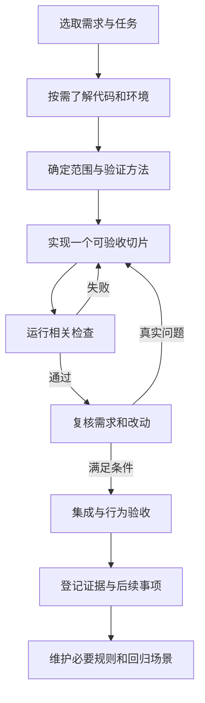

# 编程 Agent 编码流程实践调研

调研日期：2026 年 10 月 16 日。适用对象：以编程 Agent 辅助开发的 Electron、React、TypeScript 和 Python 项目。

建议本项目采用“规格驱动、小任务闭环、可执行 Harness、按风险复核”的流程。下面区分官方指南、第一方工程经验、研究证据与项目建议。共同做法代表本次调研材料中的交集，不等于已经存在一套统一行业标准。

本报告是调研与候选流程，尚未将建议新增为项目强制规则，也没有安装新框架或配置远端 CI。已有需求、架构和 HAR 约束继续有效。

## 1 调研对象与证据类型

| 对象 | 一手材料中的主要做法 | 证据边界 |
| --- | --- | --- |
| OpenAI Codex | 任务交代目标、上下文、约束与完成条件；项目规则保持简短，明确检查入口 | [官方使用指南](https://learn.chatgpt.com/docs/learn/best-practices)，属于使用建议 |
| Anthropic Claude Code | 让 Agent 获得可运行的验证反馈；复杂改动先探索规划，小改动可直接执行 | [官方最佳实践](https://code.claude.com/docs/en/best-practices)，包含第一方经验 |
| GitHub Copilot cloud agent | 任务清晰、范围有限，提供验收条件，准备构建与测试环境 | [官方任务指南](https://docs.github.com/en/copilot/tutorials/cloud-agent/get-the-best-results)，属于产品指导 |
| Cursor | 按复杂度安排计划，使用可验证反馈，保持改动可审查 | [官方实践文章](https://cursor.com/blog/agent-best-practices)，属于第一方建议 |
| GitHub Spec Kit | Specify → Plan → Tasks → Implement → Converge，检查实现与规格的差距 | [官方流程](https://github.github.com/spec-kit/)，属于一种可选工程流程 |
| Kiro | 支持需求优先的 Requirements → Design → Tasks，也支持设计优先；用明确行为描述验收 | [官方 Feature Specs](https://kiro.dev/docs/specs/feature-specs/)，属于产品工作流 |

厂商指南说明怎样使用产品，不是对缺陷率或效率提升的独立证明。跨产品一致出现的建议值得优先试用，实际收益仍需在本项目测量。

## 2 共同做法与关键区别

### 2.1 任务要能验收

OpenAI 与 GitHub 都强调交代目标和完成条件。项目级“实现桌面软件”需要继续拆分成能够观察结果的任务；文件范围可以提供线索，但 Agent 仍应检查实际代码，不能盲目按预设位置修改。[OpenAI 指南](https://learn.chatgpt.com/docs/learn/best-practices)、[GitHub 任务指南](https://docs.github.com/en/copilot/tutorials/cloud-agent/get-the-best-results)

**项目建议**：每个任务至少关联需求编号、预期行为、范围与验证方法。任务大小以能独立检查和回退为准，不规定统一代码行数，也不要求把紧密耦合的变更人为拆碎。

### 2.2 规划强度随复杂度变化

Claude Code 和 Cursor 均允许简单、明确的修改跳过详细规划。Spec Kit 提供完整的规格流程，且将若干分析检查列为可选；Kiro Quick Spec 则允许在前置澄清后连续生成需求、设计和任务，不要求每个阶段都再次确认。[Claude 指南](https://code.claude.com/docs/en/best-practices)、[Cursor 实践](https://cursor.com/blog/agent-best-practices)、[Spec Kit 命令说明](https://github.github.com/spec-kit/reference/agentic-sdd.html)、[Kiro Quick Spec](https://kiro.dev/docs/specs/quick-spec/)

**项目建议**：文案或局部修复使用短任务说明；跨模块功能使用小计划；数据迁移、权限和设备写操作补充影响及恢复分析。已有授权范围内的阅读、实现、检查连续推进，真正缺少必要信息或扩大授权范围时再停下来澄清。

### 2.3 常驻上下文要短且准确

Cursor 建议规则具体、限定范围，格式问题交给 linter；OpenAI 的近期指导强调按需加载文档，定期清理已经不适用的提示和技能，避免每次改动都读取整套材料。[Cursor Rules](https://cursor.com/docs/rules)、[OpenAI 指导](https://developers.openai.com/blog/rethinking-skills-and-prompts-for-gpt-6-astra)

**项目建议**：保留现有 `AGENTS.md` 导航和专题文档，不为每个编程工具复制另一套独立规则正文。切换工具时验证它实际加载了哪些指令；需要厂商特定入口时只建立薄适配。任务结束保存必要状态、证据和待办，减少对长聊天记忆的依赖。

### 2.4 执行反馈应能由 Agent 直接读取

Claude Code 强调测试结果、构建退出码和界面截图等可读取信号。GitHub 的初始化说明也提醒：环境初始化失败后，Agent 可能继续工作，所以“Agent 仍在运行”并不表示环境已经就绪。[Claude 验证建议](https://code.claude.com/docs/en/best-practices)、[GitHub 环境配置](https://docs.github.com/en/copilot/how-tos/copilot-on-github/customize-copilot/customize-cloud-agent/customize-the-agent-environment)

**项目建议**：本地与 CI 复用确定性命令；分别报告环境失败、产品失败和未执行。检查脚本应返回可靠退出码，必要测试未执行时不算相应验收通过。开发进度以行为证据为依据。

### 2.5 审查本身也可能出错

GitHub 明确说明 AI 审查存在漏报、误报或错误修复建议；OpenAI 的审查规则实践则建议把兼容性和数据边界等项目知识写成有范围的审查规则，与确定性检查配合。[GitHub 责任使用说明](https://docs.github.com/en/copilot/responsible-use/agents)、[OpenAI 审查实践](https://developers.openai.com/blog/custom-code-review-rules-for-codex)

**项目建议**：审查发现必须说明位置、触发条件、影响和依据。实现者核实后修复真实缺陷，有理由地关闭误报。独立复核提供另一种检查视角，但两个 Agent 同意不等于结果一定正确。关键权限、数据迁移、设备操作与发布结果保留人工责任人。

### 2.6 多 Agent 是可选的组织方式

Cursor 的长时间自主编码文章属于扩展实验，讨论过协调成本、角色分工和集成问题。它能说明大规模运行需要额外工程，不能证明小项目默认增加 Agent 数量就更好。[Cursor 扩展实验](https://cursor.com/blog/scaling-agents)

**项目建议**：通常由一个 Agent 对任务结果负责。确有独立研究、只读审查或互不干扰的实现任务，并且授权与环境允许时，再采用委派或独立 worktree。委派说明输入、产物、修改范围和集成责任；合并后重新执行相关检查。

### 2.7 指令与执行权限分开设计

厂商安全资料分别讨论权限、沙箱、不可信输入和网络访问；不同工具的默认环境并不一致。具体比较与来源见 [厂商调研记录](coding-agent-vendor-findings.md)。

**项目建议**：开发使用隔离数据库与模拟设备，按任务开放工具和网络。把生产凭据、真实设备写操作与外部发布放在明确的授权范围内。规则文件描述约束，操作系统、服务权限和检查机制承担可执行的限制。

## 3 对效率证据的判断

METR 的 2025 年随机对照实验覆盖 16 名熟悉成熟开源项目的开发者和 246 项任务，早期工具条件下任务平均耗时增加 19%。这不直接回答新项目或当前模型的效果。[原始研究说明](https://metr.org/blog/2025-07-10-early-2025-ai-experienced-os-dev-study/)

METR 在 2026 年更新中说明，新实验出现参与者和任务选择偏差，并行使用 Agent 也使时间测量更复杂，因此不能用后续原始估计可靠确定当前提速幅度。[研究更新](https://metr.org/blog/2026-02-24-uplift-update/)

DORA 2025 将 AI 描述为放大组织既有优势和弱点的因素，强调底层工程系统的作用。[DORA 报告入口及结论](https://dora.dev/research/2025/dora-report/)

**项目判断**：这些材料支持测量本地结果，不支持承诺某个通用提速倍数。建议关注可验收交付耗时、返工、审查投入和缺陷，而非只统计生成代码量或 Agent 同时运行数量。

## 4 面向本项目的建议工作流程

以下流程是基于调研形成的项目建议，与既有 [Harness 工程约束](../engineering-constraints.md) 对应。



| 步骤 | 必须得到的结果 | 主要责任 |
| --- | --- | --- |
| 1 任务就绪 | 需求编号、预期行为、范围、验收方法及关键依赖明确 | 人定义业务意图，Agent 补充技术调查 |
| 2 代码与环境核验 | 了解相关模块和既有改动；确认检查能运行，登记原有失败 | Agent 收集实际证据 |
| 3 适度计划 | 明确修改点、接口与验证范围，复杂工作进一步拆分 | Agent 制定技术路径，按已有授权推进 |
| 4 小步实现 | 形成可审查改动，保持与需求对应 | 实现 Agent |
| 5 验证与修复 | 相关检查执行成功，或清楚记录阻塞与未验证部分 | Agent 执行，脚本及测试判定 |
| 6 复核 | 核对正确性、遗漏、兼容性和边界，对发现逐项处置 | 人或获授权的审查 Agent；关键责任保留给人 |
| 7 集成验收 | 合并后的检查与需求行为符合预期，发布另做目标环境验证 | CI、运行验证与发布责任人 |
| 8 完成记录 | 实现位置、检查结果、证据、遗留项和追踪状态一致 | 任务责任 Agent，必要时人工验收 |

持续失败时先区分需求不清、环境问题、实现缺陷或错误验证，调整方法与计划；不能靠跳过测试、扩大权限或削弱验收来获得通过。复杂任务保存检查点与剩余事项，避免无上限重试。

## 5 建议采用的最小任务卡

任务卡可以写在任务描述或已有阶段计划中，不要求为小修改增加新文件。

```text
任务编号与关联需求：
目标行为：用户在什么条件下得到什么结果
本次范围：包含哪些行为，不包含哪些扩展
参考材料：相关设计章节、代码入口与既有约束
依赖与环境：所需工具、数据和已知基线失败
验收方法：正常、异常或边界场景及适用的检查命令
执行边界：允许的外部服务、文件、设备与预算范围
交付内容：实现位置、验证结果、未验证范围与遗留项
```

例如，实现“任务取消”时，验收至少覆盖排队取消、运行中停止后续调度，以及在途设备动作仍待核对。测试证明这些行为，比只检查存在取消按钮更有意义。具体切片对应既有 REQ-009、REQ-010 和 HAR-007。

## 6 定义可完成与可发布

单项功能满足以下条件后才进入“已验证”：

- 实现覆盖该任务约定的需求行为及相关边界。
- 相关检查确实运行，有实际结果，已解释原有失败与环境限制。
- 未通过删除必要检查、无依据地放宽断言或伪造成功完成验证；验收调整有需求依据。
- 复核发现的真实缺陷已修复或有不阻碍当前交付的明确处置。
- 实现位置与证据登记到追踪表，未验证范围保持可见。

发布还需要相应版本的安装、数据迁移与恢复、双模式及目标 Windows 环境验收。界面截图提供外观证据，API 与数据断言提供行为证据，二者按需求组合使用。

发现 bug 时优先复现，再采用能够防止再次出现的回归用例。对低影响、可逆的文案和样式调整按实际影响验证，不把“所有改动必须先写失败测试”或统一覆盖率数字设置为默认硬规则。

## 7 与当前仓库的对应

| 能力 | 当前状态 | 后续动作 |
| --- | --- | --- |
| 需求、设计与实施顺序 | 已有需求 1.0、架构与 M0 至 M6 计划 | 复用现有文档，按变化更新 |
| 持久开发导航 | 已有 `AGENTS.md` | 随实际命令建立持续校准 |
| 追踪与证据结构 | 已有追踪表与文档检查 | 开始编码时填写真实代码及运行证据 |
| 可直接执行的阶段任务 | 已有里程碑，尚未细化首批任务卡 | 将 M1 拆成可验收切片 |
| 产品环境及统一检查入口 | 尚未建立 | M1 锁定依赖，建立环境与类型等检查 |
| 导入边界及契约检查 | 尚未建立 | M1 对应 HAR-003、HAR-004 |
| 故障回归与 Agent 行为评测 | 尚未建立 | M2 建 mock 回归，M4 验证真实模型 |
| 桌面、安装包与 CI | 尚未建立 | 按 M1、M3 和发布阶段逐步接入 |

本项目已经具备规格驱动的主要文档结构。优先落地下一条真实交付链，比整体迁入另一套生成相似文档的框架更合适。这是项目适配判断，不是对 Spec Kit 或 Kiro 的普遍评价。

建议 M1 首批切片按依赖推进：环境与依赖锁定 → 最小 Python 服务与健康契约 → Electron 基础窗口及受限桥接 → 契约生成与统一检查。每个切片关联既有需求和 HAR 条目，验收开发骨架；完整任务流和正式安装包仍在原实施阶段交付。

## 8 应避免的流程负担

- 每个小改动都重复需求、设计和长计划的全套流程。
- 自动安装大量 MCP、技能或多 Agent 角色，却没有真实任务需要。
- 并发修改共享文件，缺少隔离、归属和集成检查。
- 让实现者修改验收含义以掩盖失败，或将 AI 审查意见一律当作真实缺陷。
- 依赖自然语言规则阻止所有越界行为，而未核验工具权限和执行环境。
- 只记录生成量、测试数量或短期“全绿”，遗漏用户行为与运行证据。

OpenAI 的工作流示例明确说明，大部分计划和上下文文件只是可选工程约定。采纳时保留方法，按现有仓库结构裁剪，不需要照搬全部目录和审批步骤。[官方工作流示例](https://developers.openai.com/cookbook/examples/codex/iterating-development-workflows-with-codex)

## 9 如何检验流程有没有改善项目

先记录本项目基线，再比较相似任务，区分编码、等待环境、验证、审查和返工时间。至少关注：需求验收交付耗时、交付后缺陷、返工比例、审查问题的有效性、环境失败原因、安装成功情况，以及单任务 Agent 成本。

这些指标是本项目的候选观察项，暂不设没有数据依据的固定目标。小样本、任务难度变化和并行执行会影响结果，不能把短期变化直接解释为某种模型或流程的因果效果。

详细的非 OpenAI 厂商来源摘要见 [厂商实践调研](coding-agent-vendor-findings.md)。本报告及该摘要仅保存研究与建议，落地仍应通过既有需求追踪和实施阶段管理。
